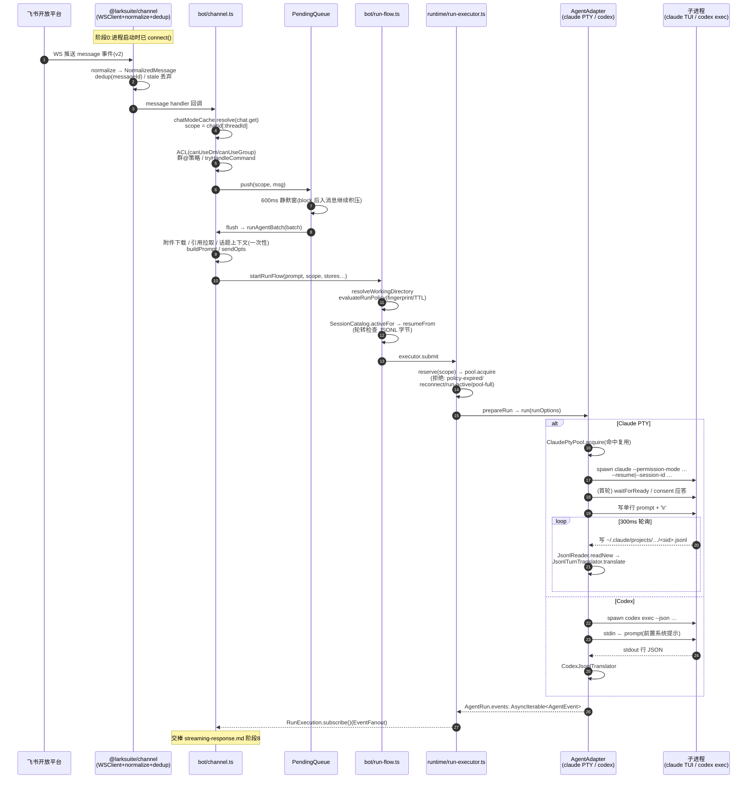

# 核心链路:一条飞书消息如何到达 Agent(接收 → 解析 → 路由 → 执行)

> 生成时间:2026-10-24。分支 `feat/topic-root-context`。
> 追踪范围:用户在飞书发送一条普通文本消息(非命令、可含附件/引用),到 Claude Code / Codex 子进程开始产出事件为止。
> 回传侧见配套文档 [streaming-response.md](./streaming-response.md)。
> 证据标注:【已确认】读到实现;【推断】由调用点推断;【待验证】存在断点。

## 1. 业务场景

用户在飞书私聊发消息、或在群里 @bot。bridge 进程通过飞书开放平台的 WebSocket 长连接收到事件,判定权限与去重,把短时间内的多条消息合并成一批,组装成带上下文的 prompt,复用或新建一个本地 Agent 会话(claude TUI-PTY / codex 子进程)执行。本链路覆盖"消息落地 → agent 产出第一个事件"的全部环节。

## 2. 完整调用链(8 个阶段)

### 阶段 0:连接建立(进程启动时,一次性)

`src/cli/commands/start.ts#runStart`(`:91`)
→ `src/bot/channel.ts#startChannel`(`:186`)
→ `createLarkChannel(opts)`(`@larksuite/channel`,opts 组装见 `channel.ts:214-253`)
→ `await channel.connect()`(`channel.ts:405`)

**事件接收机制【已确认】**:SDK `LarkChannel.connect()` 内部构造 node-sdk 的 `WSClient` 并等待其 `onReady` 回调才 resolve(`node_modules/@larksuite/channel/dist/index.d.mts:716-760` 的 `connectWebSocket` 声明)。即:**飞书事件通过 open.feishu.cn / open.larksuite.com 的 WebSocket 长连接推送到本地 SDK,SDK 归一化后以内存事件回调(EventMap)分发给 bridge,bridge 全程不监听任何端口**。transport 可选 webhook,但 bridge 未配置(默认 websocket,`channel.ts` opts 无 webhook 字段)。

bridge 对 SDK 的关键配置(`channel.ts:214-253`):
- `policy: { dmMode:'open', requireMention:false, respondToMentionAll:false }` —— **SDK 层不做 ACL**,全部交由 bridge 自身 ACL(F07);
- `safety.chatQueue.enabled:false` —— 关闭 SDK 的每 chat 串行,改用自有 PendingQueue;
- `includeRawEvent:true` —— 保留原始事件体(读 `sender.sender_type`、CardKit form_value);
- `wsConfig.pingTimeout:3`(3s 活性看门狗)、`handshakeTimeoutMs:8000`、`httpTimeoutMs:30000`、`respectProxyEnv:true`、`outbound.streamThrottleMs:400`。

### 阶段 1:SDK 侧解析、去重与归一化

飞书事件(v2 schema)→ SDK 内部 dispatcher → `normalize()` → `NormalizedMessage` 对象回调 bridge 注册的 `message` handler。

**NormalizedMessage 关键字段【已确认】**(`index.d.mts:102-130`):`messageId / chatId / chatType('p2p'|'group') / senderId(open_id) / senderName? / content(text 已剥 mention 标记) / rawContentType / resources / mentions[] / mentionedBot / mentionAll / rootId? / threadId? / replyToMessageId? / createTime / raw?`。

**SDK 内置防重复/防过期【已确认】**(`index.d.mts:387-430` SafetyConfig):`dedup`(messageId 去重表,TTL 清扫)与 `staleMessageWindowMs`(过期消息静默丢弃)属"内部防御,静默丢弃、不产生 reject 事件";policy 级拒绝(如 mention_all_blocked)才发 `reject` 事件——bridge 只记日志(`channel.ts:318-320`)。**因此重复投递在 SDK 层被吸收,bridge 无需再去重**。

### 阶段 2:bridge 接入与门卫(`intakeMessage`)

`channel.on({ message: async (msg) => intakeMessage({...}) })`(`channel.ts:298-317`,每个事件包 `withTrace({chatId,msgId})` 赋 trace-id)
→ `intakeMessage(deps)`(`channel.ts:528-631`),输入 `IntakeDeps`(channel/agent/stores/pending/executor 等,msg: NormalizedMessage),返回 `Promise<void>`(纯副作用)。

顺序门卫(任一不过即 return,消息丢弃):
1. **scope 解析**:`chatModeCache.resolve(channel, msg.chatId)`(`src/bot/chat-mode-cache.ts`,一次 `chat.get` REST + 缓存)得 `p2p|group|topic`;`scope = mode==='topic' && msg.threadId ? chatId:threadId : chatId`(`:547-550`)。**会话/任务/队列的全部键控单位是 scope,不是 chatId**。
2. **ACL**:`chatType==='p2p' ? canUseDm(profileConfig, controls, senderId) : canUseGroup(profileConfig, controls, chatId, senderId)`(`src/policy/access.ts:31,42`;四层身份:创建者恒通 → admins(可入任意群+管理)→ allowedUsers(DM)→ allowedChats(群)。配置来自 profile `access` 字段,owner 身份由 `src/policy/owner.ts` 30min 从飞书刷新)。未授权:未开白名单的群里被 @ 时回一次性提示(`sendNonAllowedGroupHint`,`:497-510`),其余完全沉默。
3. **群 @ 策略**:非 p2p 且 `getRequireMentionInGroup(cfg)` 且 `!msg.mentionedBot` → 丢弃(`:591-598`)。斜杠命令不豁免。`@全员` 已被 SDK `respondToMentionAll:false` 拦截。
4. **命令分流**:`tryHandleCommand(ctx)`(`src/commands/index.ts:251`)——消息以 `/` 开头且命中 handlers 表(19 个命令键,`/reset` 是 `/new` 别名)则就地处理并 `pending.cancel(scope)` 丢弃积压(`channel.ts:623-627`),**命令不进 Agent 链路**。
5. **入队**:`pending.push(scope, msg)`(`channel.ts:629`)。

### 阶段 3:合批(`PendingQueue`)

`src/bot/pending-queue.ts#PendingQueue.push`(`:34-47`):同 scope 消息累加,重置 600ms(`DEBOUNCE_MS`,`channel.ts:79`)静默定时器。定时器到点 → `flush(scope)` → `onFlush(scope, batch)` 回调(注册于 `channel.ts:263-293`):先 `pending.block(scope)`(停表,消息继续积压但不再触发 flush → **保证每 scope 串行**)→ `withTrace` 异步执行 `runAgentBatch` → finally `pending.unblock(scope)`(如仍有积压,重新武装新 600ms 窗)。

**并发防冲突三层【已确认】**:① SDK dedup(阶段 1);② PendingQueue block(scope 级串行);③ 后续阶段 6 的 ActiveRuns.reserve + ProcessPool(全局 FIFO 上限)。

### 阶段 4:批次加工(`runAgentBatch`,channel.ts:649-1090)

输入 `RunBatchDeps{channel, executor, sessions, sessionCatalog, workspaces, media, batch: NormalizedMessage[], controls, callbackAuth, scope, mode, ledger}`。逐项:

1. **附件**:`media.resolve(resourceItems, profileConfig.attachments)`(`src/media/cache.ts:37`)→ 每资源 `channel.downloadResourceToFile`(SDK,底层 im v1 messageResource.get)下载到 profile `media/` 目录;`normalizeAttachments`(`src/media/attachment.ts:56`)做类型/大小/MIME→扩展名决策(accepted/rejected/skipped)。必需附件被拒 → 阶段 5 策略拒绝整个 run。
2. **引用上下文**:批次内每条消息 `replyQuoteTargetForMessage`(thread-policy.ts:30)取被引用 messageId(排除批次内互引)→ 逐条 `fetchQuotedContext`(`src/bot/quote.ts`,REST 拉原文)→ `quotes[]`。
3. **话题上下文**(本分支主题):`threadId && getThreadContext(cfg) && !sessions.hasInjectedThreadContext(scope, threadId)` → `fetchThreadContext`(`src/bot/thread-history.ts`,拉整个话题含宿主消息,上限 20k/4k 字符)→ 成功取到内容才 `markThreadContextInjected`(内存 Set,按 `scope␟threadId` 键,重启后允许重注入一次;`src/session/store.ts:30-43`)。
4. **Prompt 组装**:`buildPrompt(batch, attachments, quotes, botIdentity, threadContext)`(`channel.ts:1514-1566`)→ `buildAgentPrompt`(`src/agent/prompt.ts:99`)输出单行结构化 prompt(PTY 需单行,见阶段 7):
   - `<bridge_context>`:chatId/chatType/senderId/senderName/senderType(从 raw.sender.sender_type 判人/机器人,`:1574-1580`)/botOpenId/mentions/threadId/messageIds;
   - `<bridge_instructions>`:`BRIDGE_AGENT_INSTRUCTIONS`(`channel.ts:83-88`,约束不得绕过 LARK_CHANNEL 环境);
   - `<thread_context>`、`<quoted_messages>`、`<interactive_cards>`(interactive 消息原始 DSL)、`<attachments>`;
   - 用户正文:多条时按发送者标注(`senderAnnotation`),剥离附件引用语法(`stripAttachmentRefs`),空正文时给唤醒提示语。
5. **回复目标**:`sendOpts = { replyTo: lastMsg.messageId, ...(shouldReplyInThread(...)?{replyInThread:true}:{}) }`(thread-policy.ts:12;话题群线程内必进线程,普通群看偏好,p2p 不线程化)。
6. **ACL 复查 + 能力**:`canUseDm/canUseGroup` 再判一次(与阶段 2 间隔了一个 debounce 窗,配置可能已变);`capability = codexCapability/claudeCapability(profileConfig)`(`src/agent/capability.ts`,声明 agentId、maxAccess、prompt 注入模式)。

### 阶段 5:运行准备(`startRunFlow`,src/bot/run-flow.ts:90-240)

输入 `StartRunFlowInput`(scopeId/scope/prompt/attachments/access/capability/全 store/executor/配置项),返回 `StartRunFlowResult`:成功 `{ok:true, execution, policy, cwdRealpath, resumeFrom?}`;失败 `{ok:false, rejectReason{code,userVisible}}`(直接 `channel.send` 可读文案给用户,`channel.ts:801-810`,**拒绝也回消息,不会静默卡死**)。

顺序:
1. `resolveWorkingDirectory(requestedCwd)`(`src/policy/workspace.ts`):workspaces.json 的 scope cwd ?? profile `workspaces.default`;校验存在/是目录/非过宽路径(根、home、系统、tmp),失败给 userVisible 理由。
2. `evaluateRunPolicy`(`src/policy/run-policy.ts:95`):access 复核 → folder allowlist 未验证拒 → 必需附件未 accepted 拒 → `clampAccess(defaultAccess, maxAccess, capability.maxAccess)` 取最严 → 映射 claude `permissionMode` / codex `sandbox`(p2p claude 默认强制 `bypassPermissions`,`claudeP2pAutoApprove`);产出 **`policyFingerprint`**(access+resource+attachment 摘要,`src/policy/fingerprint.ts:34`)与 5min TTL。指纹=会话身份的一部分,变了就不续接旧会话。
3. **会话续接**:`sessionCatalog.activeFor({scopeId, agentId, cwdRealpath, policyFingerprint})`(`src/session/catalog.ts`,sessions.json.catalog.json)优先;claude 兜底 `sessions.resumeFor(scopeId, cwd)`(sessions.json);cwd 已变的陈旧条目清除(`run-flow.ts:149-152`)。
4. **会话轮转**:claude 的 JSONL(`sessionJsonlPath` 定位 `~/.claude/projects/<encoded-cwd>/<sessionId>.jsonl`,`src/agent/claude/jsonl-path.ts`)字节数 > `sessionRotateMaxBytes` → 弃续接、catalog archive、起新会话(`run-flow.ts:159-195`)。
5. `executor.submit({scopeId, policy, sessionId, threadId, images(codex 专属), stopGraceMs, observability})`。

**消息 ↔ 会话 ↔ 任务的关联结构【已确认】**:
- scope(p2p=chatId / 话题=chatId:threadId)是主键;
- `SessionStore`(scope → `{sessionId?, cwd?, idleTimeoutMinutes?, updatedAt}`)与 `SessionCatalog`(scope+agentId+cwd+fingerprint → active/archived 条目)持久化;
- 运行期 `ActiveRuns.handles`(scope → RunHandle{run, interrupted, askQuestion?})内存表;
- run 结束的 `system` 事件回写两套存储(`recordRunSessionEvent`,`run-flow.ts:242-265`);
- 飞书消息与 run 的弱关联:replyTo 用最后一条消息 id;卡片按钮回调携带 runId+scope(签名令牌,见 streaming-response.md)。

### 阶段 6:提交与并发(`RunExecutor.submit`,src/runtime/run-executor.ts:63-214)

输入 `SubmitRunInput`,返回 `RunExecution{runId, scopeId, run(AgentRun), handle(RunHandle), subscribe(), stop()}`。

拒绝路径(4 个 `RunRejectedCode`,均抛 `RunRejected` 被阶段 5 转成用户可见文案):
- `policy-expired`:`policy.expiresAt <= now`(策略产出后 5min 才有效,防陈旧授权);
- `reconnect-in-progress`:`activeRuns.newRunsPaused()`(bridge 断连/重启窗口,`pauseNewRuns('bridge-disconnect')`,`channel.ts:449`);
- `run-already-active`:`activeRuns.reserve(scopeId)` 失败(该 scope 已有运行/预订)——**与 PendingQueue block 双保险**;
- `pool-full`:`pool.tryAcquire()` 失败(仅 nowait 路径;正常路径 `pool.acquire()` 会 FIFO 等待,cap=`getMaxConcurrentRuns(cfg)`,`src/bot/process-pool.ts:17`)。

成功路径:`reserve` → `acquire`(可等待)→ `agent.prepareRun?.(runOptions)`(codex 在此复检二进制,失败抛 SpawnFailed)→ `agent.run(runOptions)` 同步返回 `AgentRun` → `activeRuns.register(scopeId, run)` → `EventFanout.start()` **立即开始泵事件流**(不等订阅者——若上层在订阅前抛错,清理回调仍会执行,scope 锁不泄漏,`run-executor.ts:189-194` 注释)。`observeRunEvents` 包装流打 run started/completed/failed 日志。

### 阶段 7:Agent 执行(三种实现,统一 `AgentAdapter` 接口)

适配器选择:`createRuntimeAgent`(`src/cli/commands/start.ts:430-474`):`agentKind==='codex'` → CodexAdapter;否则 `getClaudeDriver(cfg)==='headless'` → ClaudeHeadlessAdapter(默认 **pty**,`src/config/schema.ts:343-347`);→ ClaudePtyAdapter。

`AgentRunOptions{runId, prompt, cwd, sessionId?, threadId?, model?, images?, sandbox?, permissionMode?, stopGraceMs?}`;返回 `AgentRun{runId, events: AsyncIterable<AgentEvent>, stop(), waitForExit(), answerQuestion?, resetIdleCheckpoint?}`(`src/agent/types.ts:127-227`)。

#### 7a. Claude PTY(默认)【已确认】

`ClaudePtyAdapter.run`(`src/agent/claude/pty-adapter.ts:84-165`):
- 内部 `acquire()`:已有 PTY 且存活(sessionId 命中 `ClaudePtyPool`,idle TTL 30min,60s 扫描回收,`src/agent/claude/pty-pool.ts:37-110`)→ 直接复用(首事件不发 `system`);否则 `spawnSession`(`:172-210`):spawn `claude --permission-mode <mode> (--resume <id> | --session-id <new-uuid>) --append-system-prompt <bridge系统提示> [--model <m>]`,cwd=realpath(保证与 claude 视角一致,JSONL 路径才能对上),env=process.env + `buildLarkChannelEnv`(`LARK_CHANNEL=1/LARK_CHANNEL_HOME/LARK_CHANNEL_PROFILE/LARKSUITE_CLI_CONFIG_DIR`,让 agent 内 lark-cli 绑定 profile)。
- `runTurn(prompt)`(`src/agent/claude/pty-session.ts:326-455`)驱动一轮:
  1. 首轮 `waitForReady()`:等 TUI 出数据后 1s 静默(或 30s 超时放行);启动 consent 对话框自动应答(`CONSENT_DIALOGS`,`:67-75`,ANSI 剥离后正则匹配 "Yes, I trust this folder"→`\r`、"Yes, I accept"→`2\r`);
  2. `syncCursorToTail()`:JSONL 游标跳到当前行数(复用会话时跳过历史);
  3. 写 prompt:**所有换行折叠为空格 + 200ms 后补 `\r`**(`:349-352`,TUI 多行态下 `\r` 会被当续行);
  4. 循环(300ms 间隔):`JsonlReader.readNew()` 增量读磁盘 JSONL → `JsonlTurnTranslator.translate(entry)` 逐条 yield `AgentEvent` → `done` 即返回;每轮检查:PTY 存活(退出→error 事件带缓冲尾巴)、软中断标志、挂死计时(`maxSilenceMs` 15min,in-flight 工具暂停)、墙钟上限、空闲检查点(3/10/30min 发 `idle_checkpoint`,不终止)。

#### 7b. Claude headless【已确认】

`ClaudeHeadlessAdapter.run`(`src/agent/claude/adapter.ts:55-165`):spawn `claude -p <prompt> --output-format stream-json --verbose --include-partial-messages --permission-mode <mode> --append-system-prompt <…> [--resume] [--model]`,stdin `ignore`;stdout 逐行 JSON → `createStreamJsonTranslator`(`src/agent/claude/stream-json.ts:53`)→ AgentEvent。每 run 一个进程,无复用。

#### 7c. Codex【已确认】

`CodexAdapter.run`(`src/agent/codex/adapter.ts:91-194`):`buildCodexArgs`(`codex/argv.ts:22-57`)构造 `codex exec --sandbox <mode> -c approval_policy="never" -c shell_environment_policy.inherit="all" --skip-git-repo-check -C <cwd> [--image …] [--ignore-user-config] [--ignore-rules] (resume <threadId> --json <threadId> - | --json -)`;`spawnProcess`(cross-spawn 封装,`src/platform/spawn.ts`);prompt 经 `prefixBridgeSystemPrompt` 前置 bridge 系统提示后一次性写 stdin(`adapter.ts:154`);`CODEX_HOME` 隔离到 profile 目录;stdout 行 JSON → `CodexJsonlTranslator`(`codex/jsonl.ts:11`,处理 thread.started/turn.started/item.started/item.completed/agent_message/turn.completed/turn.failed/error,产出含 threadId 的 done);stderr 逐行记日志,Windows 下 "not recognized" 检测即杀。

**到此处,链路交棒**:AgentRun.events 事件流被 streaming-response.md 的阶段 8 消费。

## 3. 关键代码位置表

| 环节 | 文件 | 函数/类 | 行号 |
|---|---|---|---|
| SDK 创建与事件注册 | src/bot/channel.ts | `startChannel` / `channel.on({message…})` | 186 / 298 |
| 事件接收机制 | node_modules/@larksuite/channel/dist/index.d.mts | `LarkChannel.connectWebSocket`(WSClient+onReady) | 716-760 |
| 消息归一化结构 | 同上 | `NormalizedMessage` | 102-130 |
| SDK 去重/过期 | 同上 | `SafetyConfig.dedup/staleMessageWindowMs` | 387-430 |
| 接入门卫 | src/bot/channel.ts | `intakeMessage` | 528-631 |
| ACL | src/policy/access.ts | `canUseDm`/`canUseGroup`/`isCreator` | 26-54 |
| 合批队列 | src/bot/pending-queue.ts | `PendingQueue.push/block/unblock/flush` | 34-101 |
| 批次加工 | src/bot/channel.ts | `runAgentBatch` | 649-1090 |
| Prompt 组装 | src/bot/channel.ts + src/agent/prompt.ts | `buildPrompt` → `buildAgentPrompt` | 1514 / 99 |
| 运行准备 | src/bot/run-flow.ts | `startRunFlow` | 90-240 |
| 运行策略 | src/policy/run-policy.ts | `evaluateRunPolicy` | 95+ |
| 会话续接/轮转 | src/bot/run-flow.ts + src/session/catalog.ts | `startRunFlow` 内部 + `SessionCatalog.activeFor` | 131-195 / — |
| 提交与并发 | src/runtime/run-executor.ts | `RunExecutor.submit` + `EventFanout` | 63-214 / 253 |
| scope 并发锁 | src/bot/active-runs.ts | `ActiveRuns.reserve/register` | 21-40 |
| 全局并发池 | src/bot/process-pool.ts | `ProcessPool.acquire` | 29+ |
| Claude PTY 适配 | src/agent/claude/pty-adapter.ts | `ClaudePtyAdapter.run/spawnSession` | 88 / 172 |
| PTY 会话驱动 | src/agent/claude/pty-session.ts | `PtySession.runTurn/waitForReady` | 326 / 201 |
| PTY 池 | src/agent/claude/pty-pool.ts | `ClaudePtyPool.acquire/reap` | 55 / 98 |
| Headless | src/agent/claude/adapter.ts | `ClaudeHeadlessAdapter.run` | 55 |
| Codex | src/agent/codex/adapter.ts + argv.ts | `CodexAdapter.run` + `buildCodexArgs` | 88 / 22 |
| 适配器选择 | src/cli/commands/start.ts | `createRuntimeAgent` | 430-474 |

## 4. 时序图

## 5. 异常处理(本链路段)

| 异常 | 位置 | 行为 |
|---|---|---|
| 未授权用户/群 | intakeMessage(channel.ts:567-583) | 静默丢弃;未开白名单群被 @ 时一次性提示 |
| 群内未 @bot | channel.ts:591-598 | 丢弃 |
| run 前置拒绝 | startRunFlow → runAgentBatch(:801-810) | `channel.send` 用户可读原因(access-denied / 目录问题 / 附件问题 / run-already-active 等) |
| cwd 无效/过宽 | policy/workspace.ts | 拒绝并给 userVisible 理由 |
| 必需附件被拒/未验证 folder | run-policy.ts:95+ | 拒绝整个 run |
| scope 已有运行 | run-executor.ts:74-77 | RunRejected('run-already-active')(双保险,PendingQueue block 之下仍可能:命令触发的 nowait run) |
| 全局池满 | process-pool.ts | 正常路径 FIFO 排队(等待时打 pool_waiting 指标);nowait 路径拒绝 |
| agent 二进制缺失 | CodexAdapter.prepareRun / checkRuntimeAgentAvailability(start.ts:400-415) | SpawnFailed/AgentPreflightError,进程启动期即退出;运行期 prepareRun 抛错转 SpawnFailed |
| claude spawn 失败 | pty-adapter.ts events 生成器(:105-112) | yield error(failed) 事件,流正常终结 |
| claude PTY 中途退出 | pty-session.ts:384-393 | error 事件附 ANSI 剥离后的缓冲尾巴 |
| claude 挂死 | pty-session.ts:421-434 | maxSilenceMs(15min,工具 in-flight 暂停)/maxTurnMs 到点 → error(timeout 文案) |
| bridge 重连窗口 | activeRuns.pauseNewRuns(channel.ts:449) | 新 run 拒绝(reconnect-in-progress),进行中的由 stopAll 终止 |
| 进程级未捕获异常 | start.ts:67-74 | unhandledRejection/uncaughtException 记日志不退出(丢一条回复好过崩掉 bot) |
| 附件下载失败 | media/cache.ts resolveOne | 【推断:跳过该附件并给 rejected 决策(attachment.test 有覆盖);逐行细节见 F25】 |

## 6. 已确认事实(摘要)

1. 事件接收 = 飞书 WS 长连接 → node-sdk WSClient → SDK 归一化/dedup → EventMap 回调;bridge 无监听端口、无 webhook。
2. 会话区分三键:chatId(p2p/普通群)、`chatId:threadId`(话题群)、scope 是 SessionStore/WorkspaceStore/ActiveRuns/PendingQueue 的统一主键;飞书消息与 run 通过 replyTo + 卡片回调令牌(runId/scope 内嵌)弱关联。
3. 消息 → Agent 输入 = 结构化分节 prompt(context/instructions/thread/quotes/cards/attachments)+ 系统提示(PTY `--append-system-prompt` / codex stdin 前缀)。
4. Claude 默认驱动是 PTY:每会话长驻 TUI,prompt 按键写入,事件从磁盘 JSONL 轮询读取(300ms);codex 每次一进程,stdin 喂 prompt,stdout 行 JSON。
5. 防重复:SDK dedup + stale 窗口;防并发冲突:PendingQueue block + ActiveRuns.reserve + ProcessPool cap;防陈旧授权:policy 5min TTL + fingerprint。
6. 轮次结束信号:claude JSONL 中 `system(subtype=turn_duration)` 且已见 `stop_reason=end_turn`(单独 end_turn 不可靠,Extended Thinking 会拆两条)。

## 7. 待验证问题

1. SDK dedup 的默认 TTL/容量(类型注释有字段,默认值在 SDK 实现内,未读 .mjs)。
2. `fetchThreadContext` 的分页与截断细节(20k 上限确认,分页 API 细节未逐行)。
3. `ChatModeCache.resolve` 失败时的回退值(topic 解析失败 → 按 group 处理?类型注释称 SDK 侧回退 'group',bridge 侧缓存失败行为未验证)。
4. `MediaCache.resolveOne` 下载失败的具体降级路径(推断为 rejected,未逐行核对 catch 分支)。
