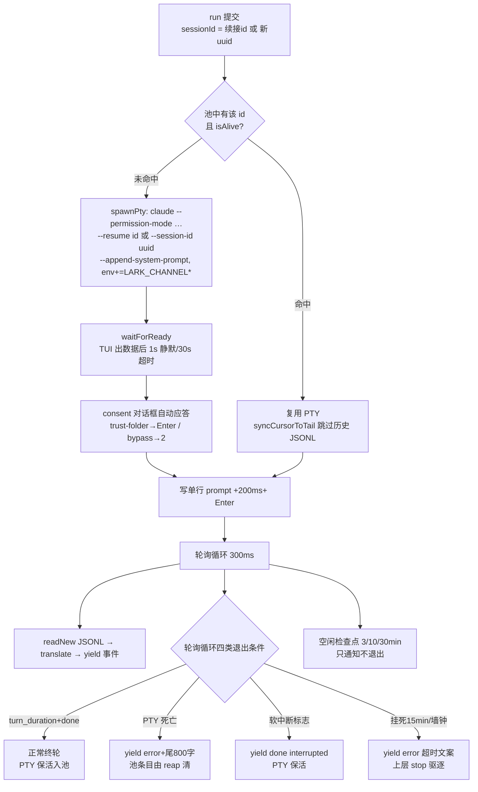

# Flow:子进程生命周期(spawn → 驱动 → 存活检测 → 终止 → 回收)

> 生成时间:2026-10-24。分支 `feat/topic-root-context`。
> 机制背景:[agent-integration.md](../agent-integration.md)(三实现对比)。本文聚焦"一个 agent 子进程从生到死的每一步",含 bridge 进程自身的兜底。

## 业务场景

bridge 是长驻进程,agent 子进程的生死直接决定消息是否被处理、内存是否泄漏、聊天是否被锁死。需要回答:何时 spawn、如何确认可用、如何感知死亡、如何分级终止、死后资源如何回收、bridge 自己异常时谁兜底。

## 1. claude TUI(PTY)全生命周期(已确认)



- **spawn 参数**(`pty-adapter.ts:172-210`):cwd 必先 realpath;`--resume` 仅当 JSONL 存在,否则 `--session-id`(uuid 由 bridge 预分配,保证 system 事件前就能持久化);env 注入 `buildLarkChannelEnv`。
- **保活语义**:一个 PTY 服务一个 Lark 会话的**多轮**对话;turn 结束不退进程;`waitForExit` 恒 true("turn 完即 exit",`pty-adapter.ts:150-156`)。
- **回收**:60s 扫描,reap 条件 = `!isAlive || idle>30min`(`pty-pool.ts:98-110`);reap/release = `hardClose`(SIGTERM→3s→SIGKILL)。`closeSession`(命令层 /new 等)与 `shutdown`(进程退出)是两个显式全量释放入口。
- **每轮并发约束**:PtySession 有 busy 标志,重入 runTurn 直接抛错(`pty-session.ts:327`)。

## 2. claude headless / codex 子进程生命周期(已确认)

两者同为"每 run 一进程、Node child API 管理":

```
spawnProcess(cross-spawn, stdio:['ignore'|'pipe','pipe','pipe'])
  ├─ stdin:codex 一次性写 prompt(前置系统提示)后 end;headless 无 stdin
  ├─ stdout:readline 逐行 JSON → 翻译器 → 事件
  ├─ stderr:逐行记日志(codex:Windows not-recognized 检测→杀);退出非零时取尾 500 字进 error
  ├─ 'error' 事件 → runtimeError(如 ENOENT)
  └─ 'exit' 事件 → exitCode;终态后 createEventStream 收尾:
       stopReason 存在(interrupted/timeout)→ translator.finish(reason)
       exitCode≠0 且未发终态 → error(带 stderr 尾)
       其余 → finish(normal)
```

- **存活检测**:`child.exitCode/signalCode !== null` 即已死;codex 防悬挂——若退出时 stdout 无任何输出,50ms 后强销毁流(`codex/adapter.ts:189-196`)。
- **终止**:`stop()` = 若已死直接返回;否则 SIGTERM → `stopGraceMs`(默认 5s,可配)内未退 → SIGKILL(codex 同时置 stopReason=interrupted 让翻译器发 done(interrupted) 而非 error)。
- **waitForExit**:等真实 exit,超时返回 false(RunExecutor 用于终态后 2s 宽限)。
- **环境隔离**:codex 独有 `CODEX_HOME` = profile 配置目录(未继承时 `<profileDir>/codex-home`),防止动用户本机 codex 配置(`codex/adapter.ts:101-107`)。

## 3. 进程树与清理责任(已确认)

bridge 进程自己的死亡路径(`cli/commands/start.ts`):

| 场景 | 动作链 |
|---|---|
| Ctrl+C / SIGTERM / `/exit` | `stop()` → `bridge.disconnect()`(停 keepalive/owner 定时器,cancelAll 队列,stopAll 运行,flush 存储)→ `agent.shutdown()`(PTY:closeAll+停扫描器)→ `unregisterSync`(注册表)→ 释放 profile/app 锁 → telemetry flush → exit(0) |
| 未捕获异常 | unhandledRejection/uncaughtException **只记日志不退出**(`:67-74`——丢一条回复好过崩 bot);真正致命的由用户重启 |
| 非 stop 路径 exit | 'exit' 钩子同步 unregisterSync + cleanupTmpFiles(`:381-384`) |
| 重启(热重连) | connect-before-disconnect;旧 agent.shutdown 释旧 PTY 池(`:285-311`) |
| OS 服务托管 | launchd/systemd/schtasks 拉起;KeepAlive 策略见 daemon 各文件 |

子进程孤儿风险:claude/codex 被 bridge 以默认 detached=false spawn,bridge 死则子进程收 SIGHUP/随会话终止【推断:未显式配 detached,Unix 下父退子孤儿由 init 收养,但 agent 会因 stdin/pty 关闭自行退出;PTY 主进程退出时 node-pty 会杀 slave——待验证】。

## 4. 存活性边界情况

| 情况 | 检测点 | 结果 |
|---|---|---|
| claude TUI 假死(进程在、无输出) | maxSilenceMs 15min(JSONL 静默+无工具) | error 终轮;stop 时 ESC 无效则硬杀 |
| ESC 被粘贴模式吃掉 | terminate 5s 后 busy 仍 true | 升级 SIGTERM/SIGKILL(`pty-session.ts:515-523`,注释明确该动机) |
| codex 起了但不吐 JSON(协议变了) | CodexJsonlTranslator ProtocolDriftState | 记 drift【降级行为待验证】 |
| spawn 瞬间失败(ENOENT) | PTY:spawnPty throw → 事件流首 error;子进程:无 pid error | run 失败,scope/池槽正常释放 |
| bridge 重启后旧 PTY 不在池 | 池是内存态,重启即空 | 新 run 重 spawn(--resume 恢复上下文,代价仅启动时间) |

## 5. 测试覆盖

单元:`tests/unit/agent/claude-pty.test.ts`(spawn/kill 封装)、`claude-pty-pool.test.ts`(复用/回收)、`claude-pty-session.test.ts`(readiness/consent/中断/按键)、`codex-prepare-run.test.ts`;进程级:`tests/process/{claude-headless,codex}-adapter.test.ts`(真实二进制替身);集成:`tests/integration/claude/pty-adapter.test.ts` + `tests/fixtures/claude-fake/claude.mjs`(假 TUI 脚本);守护:`tests/unit/daemon/*`、`tests/integration/runtime/registry.test.ts`。

## 6. 待验证问题

1. bridge 异常死亡时 PTY 子进程的实际归宿(node-pty master 死后 slave 的信号路径)。
2. `spawnProcess`(`platform/spawn.ts`,146 行小文件)对 shell/PATH 的具体处理(Windows .cmd 解析等)。
3. headless 模式 run 期间的 `stop()` 与流读取的竞态窗口(SIGTERM 后 readline 是否总能 flush 已缓冲行)。
