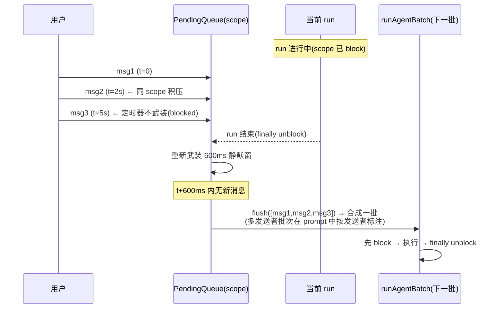

# Flow:消息队列与任务取消(连发消息 / 并发 / /stop / 超时 / 清理)

> 生成时间:2026-10-24。分支 `feat/topic-root-context`。
> 机制背景:三层并发与队列的静态结构见 [feature-catalog.md](../feature-catalog.md) F10/F11/F21;本文按事件时间线展开。

## 业务场景

用户在 agent 思考时连发三条补充;话题群里四个话题同时 @bot;agent 卡死 20 分钟;用户点"停止"按钮——每种情况都要有确定的行为:合批、并行、看门狗、可靠取消,且任何一条路径都不能把 scope 锁或并发槽泄漏(否则该聊天永久瘫痪)。

## 1. 连续发消息:时间线(已确认)

规则要点(`bot/pending-queue.ts` + `channel.ts:263-293,629`):
- **同 scope 严格串行**:flush 即 block,run 结束 unblock 才重新计时 → "每聊天同时最多一个 run"由队列结构保证;
- **运行期间的消息永远留给下一批**(不会打断当前 run;想打断必须用命令);
- 命令是唯一插队通道:`tryHandleCommand` 在 intake 即处理,并 `pending.cancel(scope)` **丢弃当前积压**(`channel.ts:623-627`)——命令语义(如 /cd)与积压消息矛盾时,以命令为准;
- **不同 scope 互相独立**(各自队列各自 run),总量受 ProcessPool 限制。

## 2. 并发模型(已确认)

三层,粒度从粗到细:

| 层 | 结构 | 粒度 | 上限 | 超限行为 |
|---|---|---|---|---|
| 全局进程池 | `ProcessPool`(`bot/process-pool.ts:17`,FIFO 等待队列) | 整个 profile | `preferences.maxConcurrentRuns`(`/config` 可调,每次 acquire 现读) | 排队(pool_waiting 指标);nowait 路径拒绝 pool-full |
| scope 单飞 | `ActiveRuns.reserve/register`(`bot/active-runs.ts:21-40`) | scope | 1(队列层已保证,这是第二道锁) | RunRejected('run-already-active') |
| 适配器资源 | `ClaudePtyPool`(会话数) | sessionId | 无上限,30min 空闲回收 | —— |

话题群场景是并发的主要来源(每话题独立 scope,`channel.ts:547-550`),ProcessPool 注释明说该场景动机(`process-pool.ts:3-7`)。

提交原子性(`runtime/run-executor.ts:63-214`):reserve → acquire → (重连暂停复查)→ prepareRun → agent.run → register,任一步失败按获取顺序逆释放;`EventFanout.start()` 在返回前就开泵,保证"上层抛错也必然触发 cleanup"(`:189-194`)。

## 3. 取消:/stop 与 stop 按钮(已确认)

两条入口、同一下游:

- **`/stop [scope]`**(`commands/index.ts:1021-1044`):不带参数=当前 scope,**不回确认消息**(在跑的渲染循环会把卡片标成"⏹ 已被中断"并重渲染,回消息反而多余);带参数(跨 scope 停别人)需 admin。
- **卡片 stop 按钮** → `handleCardAction`(cmd='stop')→ 验签(`CallbackAuth.verify`:HMAC+nonce+TTL+operator+fingerprint,`card/dispatcher.ts:131`)→ 同下游;孤儿点击(运行已结束)回友好确认而非静默(`dispatcher.ts:124-130`)。

下游:`ActiveRuns.interrupt(scope)`(`active-runs.ts:84-94`):立即从 handles 删除(scope 马上可接新 run)+ `handle.interrupted=true` + fire-and-forget `run.stop()`。

`run.stop()` 适配器实现:
- PTY:`PtySession.terminate` = 写 ESC → 等 5s(runTurn 轮询见 `interruptRequested`,yield `done(interrupted)`)→ 仍 busy 则 SIGTERM→3s→SIGKILL(`pty-session.ts:494-537`)。**PTY 本身尽量保活供下次复用**,只有硬杀才死(池会重spawn);
- 子进程模式:SIGTERM → `stopGraceMs`(默认 5s,`getAgentStopGraceMs` 可配)→ SIGKILL。

渲染侧配合:`processAgentStream` 的 for-await 在 `handle.interrupted` 时 break(`channel.ts:1178`);终态裁决 interrupted > finalize(`:1341-1342`);`handle.interrupted` 时补一次 `run.stop()` 收尾(`:1350-1352`)。RunExecution.stop 在已清理(cleaned)时是**无害 no-op**——因为会话可能已归还池里复用,再停会误杀(`run-executor.ts:202-212`)。

## 4. 超时体系(三级,已确认)

| 级别 | 名称 | 默认 | 范围 | 效果 |
|---|---|---|---|---|
| 适配器级 | maxSilenceMs | 15min | 单轮(PTY) | JSONL 静默且无工具 in-flight → error(failed),PTY 逐出 |
| 适配器级 | maxTurnMs | 关 | 单轮墙钟 | 到点 error(failed) |
| 通道级 | idle watchdog | 关(全局偏好) | 单 run | 静默 → stop + 卡片"idle_timeout N 分钟";**scope 覆盖优先**:`/timeout 1-120`(clamp,`store.ts:142-143`)/`off`(0)/`default`(清覆盖回全局);`comment:` 前缀可管评论 scope(`commands/index.ts:1046-1128`) | 

暂停/豁免规则(两级共用的语义,`channel.ts:1129-1174` + `pty-session.ts:416-421`):工具 in-flight(长构建、lark-cli OAuth 等授权)暂停计时;AskUserQuestion 待答暂停;PTY 侧用户"继续等"(检查点卡 resetIdleCheckpoint)重置节奏;通道侧首个 `idle_checkpoint`(3/10/30min)后看门狗**永久禁用**——已通知过用户,杀不杀交给卡片上的"立即终止"。

## 5. 异常退出与资源清理(已确认)

清理链按触发源:

| 触发 | 清理动作 | 代码 |
|---|---|---|
| run 正常/失败终结 | EventFanout.onDone → cleanup(waitForExit 2s)→ unregister scope + 释放池槽 + 超时补 stop | run-executor.ts:161-188 |
| 上层发送卡失败 | catch → execution.stop()(防 scope 锁泄漏) | channel.ts:1047-1057 |
| bridge 主动断连/重启 | disconnect → pauseNewRuns + pending.cancelAll + activeRuns.stopAll(全部 interrupted)+ agent.shutdown()(PTY 池 closeAll)+ 各 store flush | channel.ts:448-473;start.ts:196-217 |
| 进程信号(SIGINT/SIGTERM) | stop() → bridge.disconnect() + agent.shutdown + unregisterSync + 释放锁 + telemetry flush + exit(0) | start.ts:196-217,374-384 |
| 非正常 exit | 'exit' 钩子同步 unregisterSync + cleanupTmpFiles(兜底) | start.ts:381-384 |
| 卡死进程残留 | 下次启动 readAndPrune 按 pid liveness 清注册表;锁冲突交互确认杀旧 | registry.ts:84-109 |
| 重复事件 | SDK messageId dedup(见 message-to-agent.md 阶段 1) | —— |

**防泄漏的关键设计**(run-executor.ts:189-194 注释):事件流由 fanout 主动泵,不依赖消费者订阅——历史上"发送卡片抛错→没人订阅→cleanup 不跑→scope 永久 run-already-active"的泄漏由此修复。

## 6. 测试覆盖

`tests/unit/bot/`(队列/线程策略)、`tests/unit/runtime/run-executor.test.ts`(拒绝路径/清理/fanout)、`tests/integration/executor/run-executor.test.ts`、`tests/integration/bot/im-run-flow.test.ts`(合批)、`thread-context.test.ts`(话题 scope 并行)、`tests/integration/commands/close-session.test.ts`、`tests/unit/agent/claude-pty-pool.test.ts`(池回收)、`tests/unit/card/idle-checkpoint-card.test.ts`。

## 7. 待验证问题

1. `/stop` 指定 scope 的实际格式(scope 串 = chatId 或 chatId:threadId,用户需要知道原始 id——可用性存疑,推断主要给 admin 排障用)。
2. `pauseNewRuns` 的 pauseDepth 嵌套语义在实际重启序列中是否总是配对(release 由 disconnect 闭包持有)。
3. ~~nowait 路径的现有调用方~~(2026-10-24 交叉验证:唯一调用方是 `/doctor`,`commands/index.ts:1358`,scope=`${scope}:doctor`,群聊结果私信操作者)。
