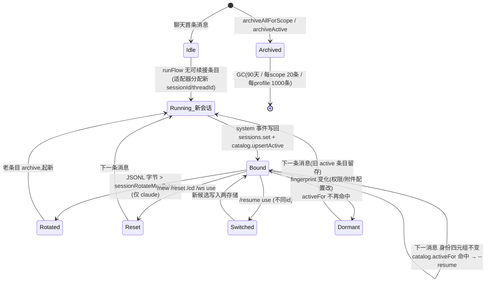

# Flow:会话生命周期(创建 → 续接 → 轮转 → 重置 → 恢复 → 归档/GC)

> 生成时间:2026-10-24。分支 `feat/topic-root-context`。
> 机制背景见 [session-and-workspace.md](../session-and-workspace.md)。本文按时间线给出每个转换的触发者与代码路径。

## 业务场景

用户希望:同一个聊天里连续对话有记忆(续接);换项目就 `/cd`(重置);会话太大变慢就自动轮转;想回到昨天修 bug 的现场就 `/resume`;一键重来就 `/new`。bridge 用"scope + 身份四元组"驱动这一切。

## 状态机总览

## 转换逐条说明

### T1 创建(首 run)

- 触发:批次 flush → `startRunFlow`(`src/bot/run-flow.ts:131-153`)查不到可续接条目。
- 动作:claude——PTY 路径预分配 uuid,spawn 用 `--session-id <uuid>`(`pty-adapter.ts:181-193`);codex——首 run 无 threadId,`thread.started` 事件带回真实 threadId。
- 写回:run 中 `system` 事件 → `recordRunSessionEvent`(`run-flow.ts:242-265`)→ claude 双写(SessionStore.set + Catalog.upsertActive),codex 只写 catalog。

### T2 续接(最常见路径)

- 触发:同 scope 下一条消息,且 `workspaces.cwdFor(scope)`、权限/附件配置都没变。
- 判定顺序(`run-flow.ts:131-153`):① `catalog.activeFor(四元组)` 命中 → claude 取 sessionId / codex 取 threadId;② claude 兜底 `sessions.resumeFor(scope, cwd)`——**要求存储的 cwd 与当前 cwd 逐字相等**(`session/store.ts:79-84`),不等返回 undefined 并在 run-flow 清掉 stale 条目(`:149-152`)。
- 使用:PTY 池命中该 sessionId 且存活 → 直接复用(连 JSONL 游标都跳到尾,`pty-session.ts:316-319`);池未命中但 JSONL 文件在 → `--resume <id>`;文件丢了 → 退回 T1 新建(`pty-adapter.ts:180-183`)。codex → `exec resume <threadId>`。

### T3 轮转(自动,仅 claude)

- 触发:续接前 `statSync(jsonl).size > sessionRotateMaxBytes`(`run-flow.ts:159-195`,偏好项,默认值见 `getSessionRotateMaxBytes`,`schema.ts:472+`)。
- 动作:`sessions.clear(scope)` + `catalog.archiveActive(四元组)` + 该 run 按新会话跑;**旧 JSONL 文件保留在磁盘**(与 /new 一致,可事后 /resume)。

### T4 重置(/new、/reset、/cd、/ws use——四条命令同一模式)

`handleNew`(`commands/index.ts:353-380`,最完整):
1. `activeRuns.interrupt(scope)`——杀正在跑的 run(fire-and-forget);
2. `sessionCatalog.archiveAllForScope({scopeId, agentId})`——**按 scope+agent 清全部活跃条目**(注释 `:361-368` 解释为什么必须 all:fingerprint 漂移会让 scope 积累多条 active,只清一条 = 悄悄没生效);
3. `releasePreviousClaudeSession`(→ `agent.closeSession(prevId)` → PTY 池 release 硬杀该会话 TUI,`:179-205`);
4. `sessions.clear(scope)`——清 thread-context markers + session 条目,**保留 idleTimeoutMinutes 偏好**(`store.ts:114-135`)。

`handleCd`(`:423-444`)/`handleWsUse`(`:490-511`):校验新目录 → 同上 1/3/4 + `workspaces.setCwd(scope, 新目录)`。**工作目录切换必然重置会话**(claude 无法跨 cwd resume,所以 /cd 语义就是"新项目新会话";文案也明示"session 已重置")。

子命令补充(2026-10-24 交叉验证确认):`/new chat [name]`(`handleNewChat`,`:384-421`)走的是另一条路——`createBoundChat` 建新群(需 `im:chat` 权限)并邀请发起者,**继承当前 cwd**(`workspaces.setCwd(新chatId, sourceCwd)`),不触碰原 scope 的会话状态。

### T5 恢复(/resume)

- 列表(`/resume [N]`,`:577-647`):**仅 p2p**(群聊不展示,防泄露他人会话);claude 扫 `~/.claude/projects/<encoded-cwd>/*.jsonl`(`session/history.ts:listRecentSessions`,按 mtime,含首行摘要预览);codex 列 thread(`codex-history.ts`);`/resume all [N]` 跨 cwd 全局扫(`listAllRecentSessions`)。
- 候选发放:每个列表项发一次性 **nonce**(`issueResumeCandidate`,模块级 Map,TTL 10min,`commands/index.ts:180-188`),卡片按钮 value 为 `{cmd:'resume.use', arg:<nonce>}`(`src/card/templates.ts:235`)→ cardAction 经 dispatcher 拆成 `runCommandHandler('resume', 'use <nonce>')`。
- 应用(`/resume use <nonce>` → `applyResume`,`:659-745`):
  - prev==新 id 则**不关 PTY**(关了会杀活会话,`releasePrevIfDifferent` 内联函数);
  - cross-cwd 候选(`/resume all` 来源)先 `workspaces.setCwd(scope, targetCwd)`;
  - `activeRuns.interrupt` + 写回两存储(claude set sessionId / codex upsert threadId)。

### T6 休眠(fingerprint 漂移)

- 触发:`/config` 改了 access/附件策略 → 下次 run 四元组不匹配 → 不续接、起新条目;旧 active 条目留存(T4 的 all-archived 才会清)。这是"权限变更后不带旧上下文"的安全语义。

### T7 归档与 GC

- 归档来源:T3/T4/T5 切换(`archiveActive`/`archiveAllForScope`)。
- `gc()`(`catalog.ts:161-195`,archived 超 90 天、每 scope 超 20 条、每 profile 超 1000 条裁剪)**当前无任何生产调用点**(2026-10-24 交叉验证:`grep -rn '\.gc(' src/` 仅命中定义与单元测试;start.ts 只调用 `load()`)——即 archived 条目实际无限累积,catalog 文件会缓慢增长。对比:日志 GC(`gcOldLogs`)与媒体 GC(`gcMediaCache`)在 start.ts:156-157 有真实调用。

## 关键代码位置表

| 转换 | 文件:函数 |
|---|---|
| 续接判定 | run-flow.ts:131-153;session/store.ts:79-84;session/catalog.ts:88-100 |
| 轮转 | run-flow.ts:159-195 |
| /new 全清 | commands/index.ts:353-380;catalog.ts:143-155 |
| /cd、/ws use | commands/index.ts:423-444 / 490-511;workspace/store.ts:38-41 |
| /resume 列表/应用 | commands/index.ts:577-647 / 659-745;session/history.ts;codex-history.ts |
| PTY 释放 | commands/index.ts:189-209 → pty-pool.ts:77-86 |
| 写回 | run-flow.ts:242-265 |
| GC | session/catalog.ts:161-195(⚠ 无生产调用点) |

## 异常分支

| 异常 | 行为 |
|---|---|
| 重置时有 run 在跑 | interrupt 先行;卡片终态标 interrupted(渲染循环自然收尾) |
| closeSession 失败 | 记 warn 继续(PTY 由 30min TTL 兜底回收) |
| /resume nonce 过期/伪造 | "未找到"回复 |
| 跨 cwd 恢复后目录又被删 | 下次 run resolveWorkingDirectory 拒绝,userVisible 提示 |
| 两存储不一致(catalog 有、sessions 无) | 判定顺序天然兼容:catalog 优先;claude 才需要 sessions 兜底 |

## 测试覆盖

`tests/integration/session/resume.test.ts`(T2/T5 端到端)、`tests/integration/commands/resume-command.test.ts`、`close-session.test.ts`(T4 PTY 释放)、`commands-v1.test.ts`(/new)、`tests/unit/session/{store,catalog,history}.test.ts`、`tests/unit/policy/workspace.test.ts`。

## 待验证问题

1. ~~catalog `gc` 的实际调用点~~(已验证:**不存在生产调用点**,见 T7;为何未接线需向上游确认)。
2. ~~`/resume` 卡片按钮回调链~~(已验证:value=`{cmd:'resume.use', arg:<nonce>}`,dispatcher 拆发;见 T5)。
3. codex thread 的磁盘存储(rollout 文件)与 `listCodexThreadHistory` 的读取路径。
