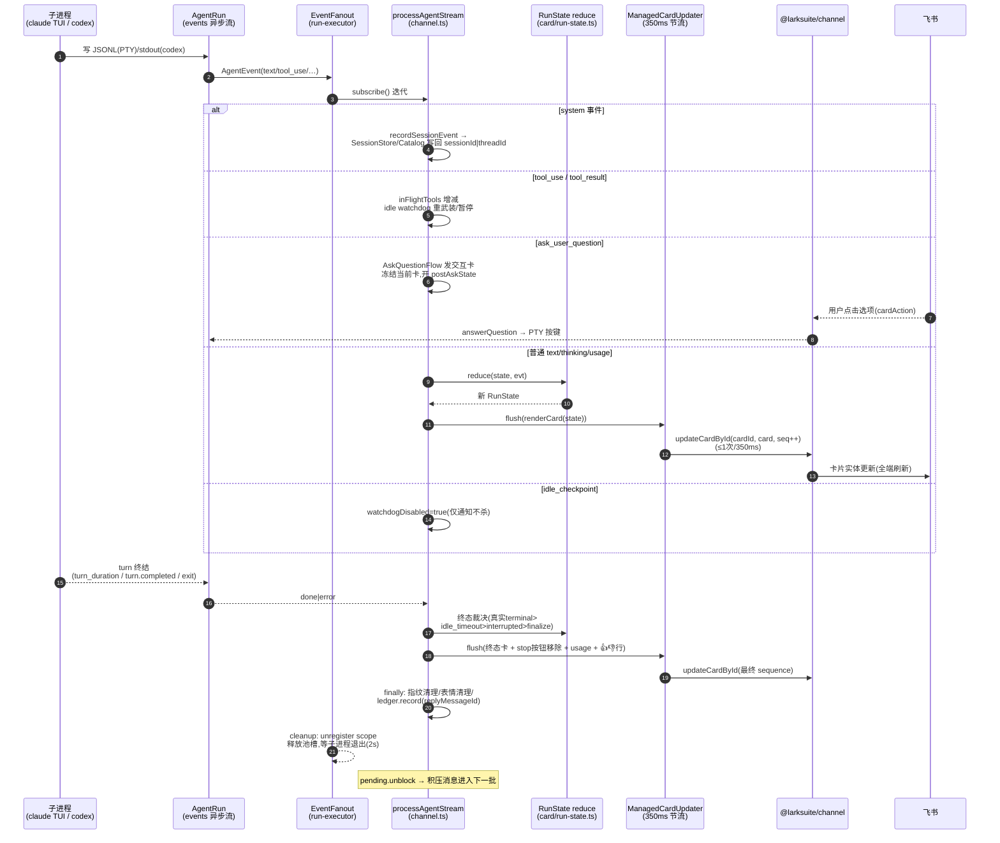

# 核心链路:Agent 输出如何流式回到飞书(读取 → 翻译 → 状态机 → 渲染 → 回传 → 终态)

> 生成时间:2026-10-24。分支 `feat/topic-root-context`。
> 前置文档:[message-to-agent.md](./message-to-agent.md)(阶段 0-7:消息接收到 Agent 执行)。本文从阶段 7 产出的 `AgentRun.events` 事件流开始。
> 证据标注:【已确认】读到实现;【推断】由调用点推断;【待验证】存在断点。

## 1. 业务场景

Agent(claude / codex)开始执行后,bridge 需要把**过程**(文本增量、工具调用、todo、token)与**结果**(最终回复、失败原因、中断/超时标记)准实时地呈现给飞书用户:默认一张不断刷新的流式卡片,或 markdown 打字机流,或纯文本一次性回复;并在结束后落账、清理装饰、释放并发槽。

## 2. 完整调用链(阶段 8-11)

### 阶段 8:输出读取(Agent 侧,事件如何产生)

统一出口:`AgentRun.events: AsyncIterable<AgentEvent>`(`src/agent/types.ts:147-150`)。`AgentEvent` 联合:`system / text / thinking / tool_use / tool_result / idle_checkpoint / ask_user_question / usage / done / error`(`:69-123`)。

三种读取机制【已确认】:

| 驱动 | 读取源 | 翻译器 | 终止信号 |
|---|---|---|---|
| Claude PTY(默认) | **磁盘 JSONL 轮询**(300ms,`JsonlReader.readNew`,游标增量,文件重建自愈,`src/agent/claude/jsonl-reader.ts:18-36`);PTY stdout 仅用于就绪检测/consent 匹配/退出诊断 | `JsonlTurnTranslator`(`jsonl-translate.ts:155-301`) | `system(subtype=turn_duration)` 且 `_endTurnSeen` → yield `usage` + `done(normal)`(`:288-299`);另:PTY 退出→error、软中断→done(interrupted)、挂死→error |
| Claude headless | 子进程 stdout 逐行 JSON(`claude -p --output-format stream-json --include-partial-messages`) | `createStreamJsonTranslator`(`stream-json.ts:53`) | stream-json `result` 行【待验证:翻译器内部映射细节未逐行】 |
| Codex | 子进程 stdout 逐行 JSON(`codex exec --json`) | `CodexJsonlTranslator`(`codex/jsonl.ts:11-73`) | `turn.completed`→done(threadId);`turn.failed`/error→error;stop 置 stopReason→finish(interrupted) |

**Claude JSONL 翻译关键细节【已确认】**(`jsonl-translate.ts`):
- `assistant` 条目:累加 usage(input+cache_creation+cache_read、output);`content[]` 内 `text`→`text` 事件、`thinking`→`thinking`、`tool_use`→配对入 `currentTools` 并 yield `tool_use`(含 `humanLabel`:Bash·命令、Edit·文件路径等,`:27-64`);
- `model === '<synthetic>'` 的 assistant 条目**跳过**(claude 中断/续接后自造的记账轮,渲染出来会是模型没写过的话,`:200-205`);
- `stop_reason==='end_turn'` 只置 `_endTurnSeen` 标志,**不直接终止**——Extended Thinking 会拆成"纯思考 end_turn + 正文 end_turn"两条,提前终止会丢正文(`:145-155` 注释);
- `user` 条目:`tool_result` 出队 in-flight、yield `tool_result`(isError);
- todo 类工具(TaskCreate/TaskUpdate/TodoWrite)在 tool_use 时即时解析进快照(`:236-243`);
- `AskUserQuestion` 特判为结构化 `ask_user_question` 事件(不作为普通 tool_use,`:244-261`)。

**流式程度**:文本以 content block 为粒度增量(非逐 token);token 计数随每个 assistant 条目增量;headless 模式因 `--include-partial-messages` 可到 token 级【推断,来自该 flag 注释:"without this, stream-json only emits whole assistant messages"】。

### 阶段 9:事件消费与状态机(`processAgentStream`)

调用点:`runAgentBatch` 内 `execution.subscribe()`(=`EventFanout.subscribe()`,缓冲扇出,多订阅者共享,`src/runtime/run-executor.ts:253-322`)→ 三路之一调用
`processAgentStream(handle, eventStream, scope, idleTimeoutMs, recordSession, flush, flushNewCard?, onIdleCheckpoint?)`(`src/bot/channel.ts:1097-1354`)。

输入:`RunHandle`(run/interrupted/askQuestion)、事件流、flush 回调;返回:终态 `RunState`。

**纯函数状态机**(`src/card/run-state.ts`):`reduce(state: RunState, evt: AgentEvent): RunState`(`:53-168`)把事件折叠为 `RunState{blocks: Block, reasoning, todos, usage, footer: 'thinking'|'tool_running'|'streaming'|null, terminal: 'running'|'done'|'interrupted'|'error'|'idle_timeout', errorMsg?, idleTimeoutMinutes?}`(`:27-38`)。每次 reduce 后 `flush(state)` 触发渲染回传(见阶段 10);`terminal !== 'running'` 即 break 退出循环(`channel.ts:1328`)。

**`system` 事件旁路**:`recordSession(evt)` → `recordRunSessionEvent`(`src/bot/run-flow.ts:242-265`)把 claude sessionId / codex threadId 写回 `SessionStore` + `SessionCatalog`(upsertActive)——**这是"任务 ↔ 会话"关联的写回点**。

**通道级空闲看门狗**(`channel.ts:1129-1174`):`idleTimeoutMs`(scope 级 `/timeout N` 覆盖 > 全局偏好,默认关)到点 → `handle.interrupted=true` + `run.stop()`,终态标 `idle_timeout`(分钟数写进 RunState,卡片显示"⏱ N 分钟无响应,已自动终止",`run-renderer.ts:76-78`)。**暂停计时的两个集合**:`inFlightTools`(tool_use 未见 tool_result——长工具如 OAuth 等待是合法静默)与 `pendingAskQuestions`(等待用户点卡片)。首个 `idle_checkpoint` 事件后 `watchdogDisabled=true`(已通知过用户,杀不杀由用户在检查点卡上决定)。

**AskUserQuestion 分支**(`:1200-1228`):事件到达 → `handle.askQuestion.start(id, questions)`(`AskQuestionFlow`,发交互卡)→ 当前流式卡冻结为 done + 开新累加器 `postAskState` → 用户点击 → 卡片回调(F19 鉴权)→ `AgentRun.answerQuestion` → PTY 写按键(claude 自己合成 tool_result)→ 后续事件进 `postAskState`,终态经 `flushNewCard` 发**新卡**。

**终态优先级**(`:1338-1346`):真实 terminal 事件 > idleFired(idle_timeout)> interrupted > `finalizeIfRunning`(兜底转 done)——防止"已完成但 flush 慢,被迟到的看门狗改成超时"。最后 `flush(state)` 一次,`handle.interrupted` 时补 `run.stop()`。

### 阶段 10:渲染与回传(按 `getMessageReplyMode` 三路,channel.ts:933-1046)

公共输入:`cardRenderOptions()`(签名函数 `signCallback`=CallbackAuth HMAC(密钥=App Secret)+nonce,24h TTL,载荷含 runId/scope/chatId/operator/action/policyFingerprint;`toolDisplay`;`staticMode:true`;feedback 行配置)与 `textRenderOptions`。所有发送点复用同一 `sendOpts`(replyTo=批次最后一条消息,按需 replyInThread)。

#### 10a. card 模式(默认)

1. `sendManagedCard(channel, chatId, renderCard(initialState, opts), sendOpts)`(`src/card/managed.ts:28-57`):`channel.createCard(card)` 建 **CardKit 2.0 卡片实体**(cardkit.v1.card.create)得 cardId → `channel.send(recipient, {cardId})` 发引用该实体的消息 → 模块级 Map 记 `messageId → {cardId, sequence:0}`。
   - **回帖目标已撤回的容错**:replyTo 消息被撤回(飞书码 230011/230017/230020)→ 降级为顶层重发(`managed.ts:44-54`);
2. 每次状态更新:`ManagedCardUpdater.schedule(renderCard(state,…))`(`channel.ts:1472-1512`)——**350ms 合并节流**(每 token flush 但至多 350ms 一次更新;只保留最新渲染;FIFO 链保证 `updateCardById` 的 sequence 单调);
3. `updateManagedCard`(`managed.ts:88-104`):`channel.updateCardById(cardId, card, ++sequence)`(cardkit.v1.card.update,**sequence 必须严格递增**,飞书拒绝乱序,SDK 注释 .d.mts:786-793)——全量替换式更新,`staticMode` 关闭卡片 `streaming_mode`(`run-renderer.ts:105-112`)以便结束后仍可更新(反馈计数);
4. 终态:`updater.flush(终态卡)`;正常结束且配置 ledger → `registerFeedbackCard(messageId, {entryId: runId, update})`(👍/👎 行,点击经 F19 fb 回调刷新计数)。

**为什么用实体卡**:实体更新推送到所有已渲染客户端且按钮回调后卡片仍存活——流式内嵌卡(streaming_mode)结束后进入只读生命周期,投票行刷新不了。

#### 10b. markdown 模式

1. 先 `addWorkingReaction(channel, lastMsg.messageId)`(`src/bot/reaction.ts`,非 card 模式的即时"正在输入"提示;失败静默——装饰不能坏了回复);
2. `processAgentStream` 的 flush 回调缓存 `latestState`;
3. `channel.stream(chatId, { markdown: async (ctrl) => { … await ctrl.setContent(renderText(latestState)) … } }, sendOpts)`:SDK `MarkdownStreamController.setContent(full)` 全量更新打字机消息,**SDK 侧 400ms 节流**(`outbound.streamThrottleMs`,`channel.ts:236-238`)+ **单卡 30000 字符上限自动滚动新卡**(SDK OutboundConfig 注释:飞书 cardElement 尺寸限制,超限 code 11310)。
4. 竞态治理 `awaitRenderAwareStream`(`channel.ts:1356-1412`):
   - stream 先失败(如没权限发消息)→ 等渲染完成 → `runFallbackReply`(普通 `channel.send` 一次性发终态文本);
   - render 先完成但 producer 从未启动(SDK 在 markdown producer 首次 setContent 前不会发消息)→ fallback;
   - 双方都在跑 → 等两者,stream 完成再给 3s 宽限(`STREAM_TERMINAL_GRACE_MS`);
   - 任何 fallback 失败仅记日志。

#### 10c. text 模式

运行期间零输出(只有 typing 表情),结束后 `renderText(finalState)` 一次性 `channel.send({markdown})`(msg_type=post)。

**渲染内容**(`renderCard`,`src/card/run-renderer.ts:54-113`):思考面板(reasoning,上限 1500 字)、text/tool 交错段落(toolDisplay full=含输入输出详情 / compact=单行 / hide=仅 footer"🧰 正在调用工具")、终态注记(interrupted/idle_timeout/error/未返回内容)、运行中 footer(thinking/tool_running/streaming)+ **stop 按钮**(签名令牌)、usage 尾注、done 后反馈行。`renderText`(`src/card/text-renderer.ts:32`)输出等价 markdown 纯文本。

### 阶段 11:收尾(`runAgentBatch` finally,channel.ts:1058-1089)

1. `activePolicyFingerprints.delete(scope)`(卡片回调鉴权的活指纹);
2. typing 表情清理(1s 宽限内等 reaction id,超时异步补删,`scheduleWorkingReactionCleanup`,`:1426-1458`);
3. ledger 落账:`replyMessageIdReady`(1.5s 竞速)拿回复消息 id → `ledger.record({id: runId, openId, name, chatId, chatKind, tokens, costUsd, replyMessageId})`(👍/👎 表情按 replyMessageId 归因到本次交互);
4. RunExecutor 侧清理(事件流终结时由 `EventFanout.onDone` 触发):`cleanup(waitForExit=2s)`——unregister scope、释放池槽、等子进程自然退出,超时补 `run.stop()`(`run-executor.ts:161-188`);
5. `pending.unblock(scope)`(阶段 3 finally):运行期间积压的消息重新计时,合并成下一批。

## 3. 关键代码位置表

| 环节 | 文件 | 函数/类/方法 | 行号 |
|---|---|---|---|
| 事件流扇出 | src/runtime/run-executor.ts | `EventFanout.pump/subscribe` | 253-322 |
| Claude JSONL 增量读 | src/agent/claude/jsonl-reader.ts | `JsonlReader.readNew/setCursor` | 18-36 |
| Claude 事件翻译 | src/agent/claude/jsonl-translate.ts | `JsonlTurnTranslator.translate` | 194-301 |
| codex 事件翻译 | src/agent/codex/jsonl.ts | `CodexJsonlTranslator.translate/finish` | 22-73 |
| headless 翻译 | src/agent/claude/stream-json.ts | `createStreamJsonTranslator/translateEvent` | 53/129 |
| 事件消费主循环 | src/bot/channel.ts | `processAgentStream` | 1097-1354 |
| 状态机 | src/card/run-state.ts | `reduce`/`markInterrupted`/`markIdleTimeout`/`finalizeIfRunning` | 53/178/188/199 |
| 会话写回 | src/bot/run-flow.ts | `recordRunSessionEvent` | 242-265 |
| 卡片渲染 | src/card/run-renderer.ts / text-renderer.ts | `renderCard` / `renderText` | 54 / 32 |
| 实体卡生命周期 | src/card/managed.ts | `sendManagedCard`/`updateManagedCard` | 28 / 88 |
| 卡片更新节流 | src/bot/channel.ts | `ManagedCardUpdater` | 1472-1512 |
| markdown 流竞态 | src/bot/channel.ts | `awaitRenderAwareStream`/`runFallbackReply` | 1356-1424 |
| 按钮签名 | src/card/callback-auth.ts | `CallbackAuth.sign`(HMAC+nonce) | 64+ |
| 空闲看门狗 | src/bot/channel.ts | `armOrPauseIdle`(闭包) | 1160-1174 |
| Ask 交互 | src/bot/ask-question-flow.ts + pty-session.ts | `AskQuestionFlow.start` + `answerAskUserQuestion` | — / 246-309 |
| 反馈卡 | src/card/feedback-store.ts | `registerFeedbackCard` | 21 |
| 落账 | src/observability/ledger.ts | `LedgerStore.record/recordReaction/setVote` | 75+ |
| typing 表情 | src/bot/reaction.ts | `addWorkingReaction/removeReaction` | 15/29 |

## 4. 时序图

## 5. 异常处理矩阵(本链路段)

| 异常类型 | 检测点 | 处理 | 用户可见 |
|---|---|---|---|
| claude PTY 中途退出 | `PtySession.onExit` → runTurn `!alive`(`pty-session.ts:384`) | error 事件附缓冲尾 800 字 | 卡片"⚠️ agent 失败:claude PTY exited (code …): <尾>" |
| claude 挂死(静默) | maxSilenceMs 15min(无工具 in-flight)/ maxTurnMs(`:421-434`) | error(timeout 中文文案),PTY 由上层 stop 驱逐 | 卡片超时注记 |
| codex 非零退出 | `createEventStream` 退出码分支(`adapter.ts:230-247`) | 未发终态时 error(附 stderr 前 500 字) | 卡片失败注记 |
| codex spawn 失败/无 pid | run 生成器首查(`adapter.ts:176-186`) | error(failed) | 卡片失败注记 |
| 事件流中途抛错 | EventFanout.pump catch(`run-executor.ts:310-312`) | error 存入 fanout,订阅者 next() 抛出 | 上层 catch(见下) |
| **卡片发送失败**(首卡 send 抛) | runAgentBatch catch(`channel.ts:1047-1057`) | `execution.stop()` 强停 run,防 scope 锁泄漏;processAgentStream 若已在跑则随流终结自然收尾 | 用户看不到卡(发送都失败,无渠道可提示) |
| 卡片更新失败 | ManagedCardUpdater.fire catch(`:1500`) | 记日志继续(下一次 schedule 重试全量替换;sequence 机制保证旧更新不会覆盖新状态) | 卡片停在最后成功帧 |
| **markdown 流失败** | awaitRenderAwareStream(`:1371-1381`) | 等渲染完成后 fallback 一次性 send 终态全文 | 收到完整结果(无流式效果) |
| producer 未启动竞态 | producerStarted 检查(`:1389-1393`) | fallback 普通消息 | 同上 |
| 回帖目标被撤回 | sendManagedCard isDeadReplyTarget(`managed.ts:63-81`) | 降级顶层重发(保留 replyInThread) | 卡片仍送达 |
| 看门狗触发 | armOrPauseIdle 定时器(`:1165-1172`) | run.stop + `markIdleTimeout` | "⏱ N 分钟无响应,已自动终止" |
| 用户主动取消 | `/stop` 命令或卡片 stop 按钮 → `ActiveRuns.interrupt` / `execution.stop` | PTY:ESC 软中断→5s→SIGTERM→SIGKILL;codex:SIGTERM→grace→SIGKILL | 终态"⏹ 已被中断" |
| run 结束但子进程不退 | cleanup waitForExit 2s 超时(`run-executor.ts:166-180`) | 补 stop() | 无(仅日志 post-done-exit-timeout) |
| 全局兜底 | process unhandledRejection/uncaughtException(`start.ts:67-74`) | 记日志+reportError,不退出 | 单条回复可能丢,bot 存活 |
| bridge 断连 | disconnect → activeRuns.stopAll(`channel.ts:454-461`) | 所有运行 interrupted+stop,store flush | 卡片停在最后帧;重连后发 `/reconnect` 或 keepalive 自动恢复 |

## 6. 已确认事实(摘要)

1. **流式反馈是三级节流管道**:agent 事件原生粒度(text block 级)→ bridge `reduce` 每事件一帧 → 卡片路径 `ManagedCardUpdater` 350ms 合并 → SDK `updateCardById`(sequence 严格递增);markdown 路径靠 SDK `streamThrottleMs=400ms` + 30k 字符自动滚卡。
2. **Claude 输出读取 = 磁盘 JSONL 轮询**(300ms),不是进程 stdout;轮次结束以 `system(turn_duration)` 为准;`<synthetic>` 条目跳过。
3. **默认卡片是 CardKit 2.0 实体卡**:createCard 建实体 + send(cardId) 发消息 + updateCardById 全量更新;实体更新对按钮回调存活,支持结束后改投票计数。
4. **三处容错降级**:markdown 流失败→一次性 fallback;replyTo 被撤回→顶层重发;渲染与流的各种竞态→awaitRenderAwareStream 仲裁。
5. **超时是三级体系**:适配器级(maxSilence 15min/maxTurnMs)+ 通道级 idle watchdog(可 `/timeout` per-scope)+ 用户级(检查点卡"立即终止")。三级互斥协调:in-flight 工具与待答问题暂停计时;首个检查点后通道看门狗永久禁用。
6. **终态裁决有序**:真实 terminal 事件 > idle_timeout > interrupted > finalize 兜底;`markInterrupted/markIdleTimeout/finalizeIfRunning` 均为纯函数(`run-state.ts:178-207`)。

## 7. 待验证问题

1. headless `stream-json.ts` 的事件映射细节(`translateEvent` 129 行起未逐行;特别是不发 `system` 会话事件时 sessionId 如何回写——headless 每 run 新进程且 `--resume` 由 bridge 指定,推断不需要写回但未见代码)。
2. SDK 打字机 30k 滚卡与新卡 `messageId` 的衔接(滚卡后 `MarkdownStreamController.messageId` 是否切换,影响 ledger 的 replyMessageId 归因)。
3. `AskQuestionFlow` 卡片的具体渲染与超时行为(`ask-question-card.ts` 363 行文件只读了导出)。
4. codex `CodexJsonlTranslator` 的 protocol drift 检测(`ProtocolDriftState`)在什么条件触发降级。
5. PTY 会话池命中的 run,model 参数不生效(绑定在 spawn 时,`pty-pool.ts:13-16` 注释确认,但用户 `/model` 类指令是否存在【未见对应命令,推断无】)。
